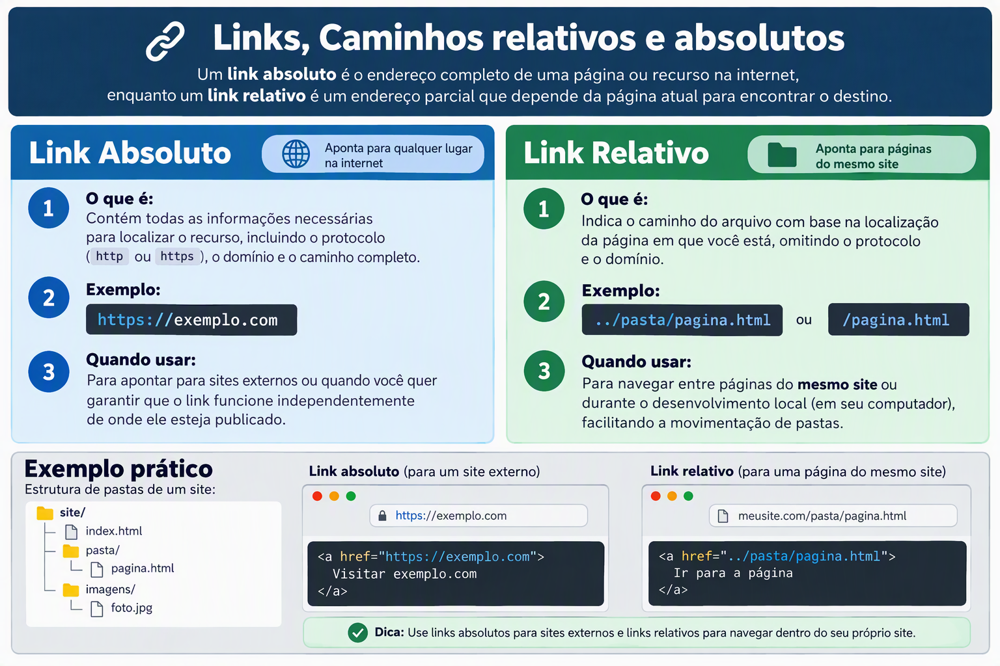
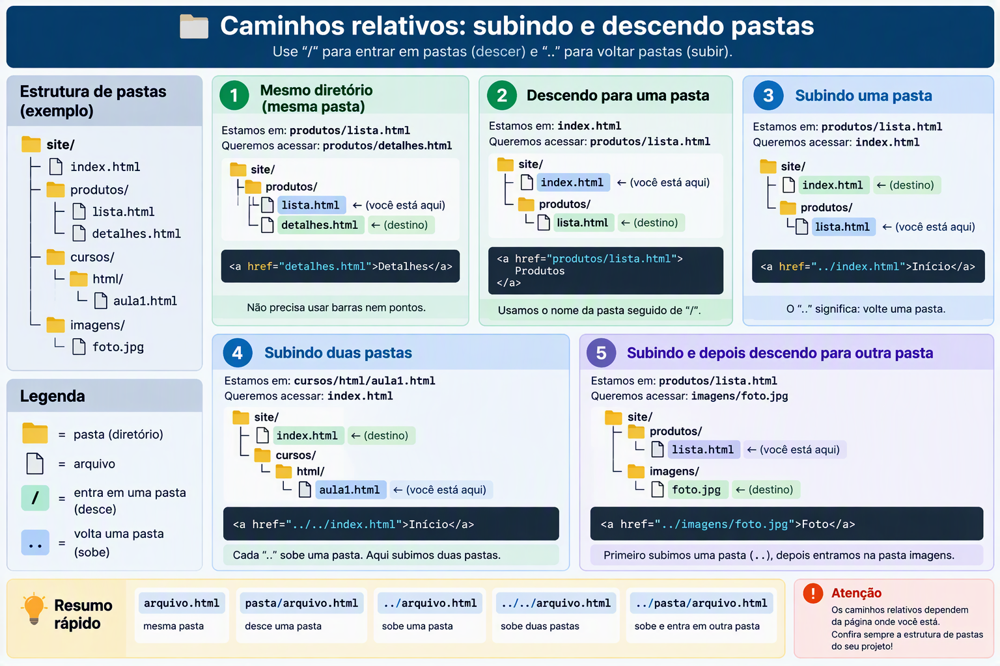

# caminhos
# Links, Caminhos Relativos e Caminhos Absolutos, qual escolher?

# Links e caminhos em HTML

Os links permitem conectar páginas, arquivos, imagens e outros recursos. Eles podem utilizar **caminhos absolutos** ou **caminhos relativos**.



## Detalhamento: como subir e descer pastas

A imagem abaixo apresenta uma árvore de diretórios em formato semelhante a um diagrama ASCII. O objetivo é mostrar como a localização do arquivo atual determina o caminho relativo usado no atributo `href`.



### Regra principal

```text
.   = pasta atual
..  = pasta acima
/   = separa os nomes das pastas e dos arquivos
```

> O caminho sempre deve ser interpretado a partir da pasta na qual está o arquivo HTML atual.

## Estrutura de pastas usada nos exemplos

```text
site/
├── index.html
├── produtos/
│   ├── lista.html
│   └── detalhes.html
├── cursos/
│   └── html/
│       └── aula1.html
└── imagens/
    └── foto.jpg
```

## 1. Arquivo na mesma pasta

Se o arquivo atual é `produtos/lista.html` e o destino é `produtos/detalhes.html`, basta informar o nome do arquivo:

```html
<a href="detalhes.html">Detalhes</a>
```

```text
produtos/
├── lista.html       ← arquivo atual
└── detalhes.html    ← destino
```

## 2. Descer para uma pasta

Se o arquivo atual é `index.html` e o destino é `produtos/lista.html`, informe primeiro a pasta e depois o arquivo:

```html
<a href="produtos/lista.html">Produtos</a>
```

```text
site/
├── index.html       ← arquivo atual
└── produtos/        ← entra nesta pasta
    └── lista.html   ← destino
```

O caminho `produtos/lista.html` significa:

```text
entre em produtos/ → abra lista.html
```

## 3. Subir uma pasta

Se o arquivo atual é `produtos/lista.html` e o destino é `index.html`, utilize `../`:

```html
<a href="../index.html">Início</a>
```

```text
site/
├── index.html       ← destino
└── produtos/
    └── lista.html   ← arquivo atual
```

O caminho `../index.html` significa:

```text
suba uma pasta → abra index.html
```

## 4. Subir duas pastas

Se o arquivo atual é `cursos/html/aula1.html` e o destino é `index.html`, utilize `../../`:

```html
<a href="../../index.html">Início</a>
```

```text
site/
├── index.html          ← destino
└── cursos/
    └── html/
        └── aula1.html  ← arquivo atual
```

O caminho `../../index.html` significa:

```text
primeiro ../  → sai de html/
segundo ../   → sai de cursos/
index.html    → abre o arquivo
```

## 5. Subir e depois entrar em outra pasta

Se o arquivo atual é `produtos/lista.html` e o destino é `imagens/foto.jpg`, utilize:

```html

```

```text
site/
├── produtos/
│   └── lista.html   ← arquivo atual
└── imagens/         ← depois, entra nesta pasta
    └── foto.jpg     ← destino
```

O caminho `../imagens/foto.jpg` significa:

```text
suba uma pasta → entre em imagens/ → abra foto.jpg
```

## Resumo rápido

```text
arquivo.html                 mesma pasta
pasta/arquivo.html           desce para uma pasta
../arquivo.html              sobe uma pasta
../../arquivo.html           sobe duas pastas
../pasta/arquivo.html        sobe uma pasta e entra em outra
```

## Atenção

- `../` não significa voltar para a página anterior do navegador. Significa **subir um nível na estrutura de pastas**.
- Cada novo `../` sobe mais uma pasta.
- O caminho relativo depende da localização do arquivo HTML atual.
- Em nomes de arquivos e pastas para a web, prefira letras minúsculas, sem espaços e sem acentos.
